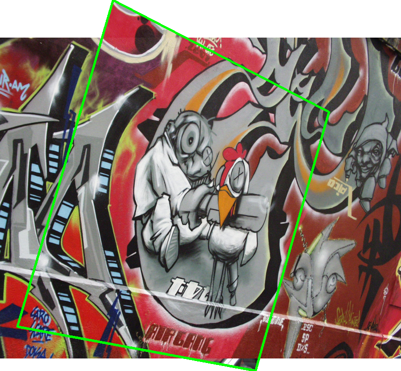

.. _homography:

What is a homography?
=====================

A **homography** (or projective transformation) is an invertible mapping between
two projective planes.  In computer vision it describes the relation between two
images of the same planar surface, or between two images taken by a camera that
only rotates around its optical centre.

Given a point :math:`\mathbf{x} = (x, y, 1)^\top` in one image, the
corresponding point :math:`\mathbf{x}' = (x', y', 1)^\top` in the other image
satisfies

.. math::

   \mathbf{x}' \sim H\,\mathbf{x},

where :math:`H` is a :math:`3 \times 3` matrix defined up to scale, so it has
eight degrees of freedom.  Each point correspondence provides two constraints,
hence at least four correspondences in *general position* are needed to
determine :math:`H` uniquely.

Homographies are one of the fundamental building blocks of multi-view geometry
and appear in panoramic stitching, augmented reality, camera calibration, and
visual odometry.  For a thorough treatment see Hartley and Zisserman
[HartleyZisserman2003]_.

Radial distortion
-----------------

Real camera lenses introduce **radial distortion**, bending straight lines
in the world into curves in the image.  HomLib provides solvers that estimate
the homography and one or more radial distortion coefficients *simultaneously*
from minimal correspondences, avoiding a separate calibration step.

A point :math:`\mathbf{x}_u` is related to its distorted observation
:math:`\mathbf{x}_d` by

.. math::

   \mathbf{x}_d = \mathbf{x}_u \bigl(1 + k\,\|\mathbf{x}_u\|^2\bigr),

where :math:`k` is the distortion coefficient (the *division model*).  The
different distortion cases supported by HomLib --- single-sided, two-sided
equal, and two-sided --- are described in :ref:`solvers`.

Example: stitching a panorama
-----------------------------

The images below show two views of the same graffiti wall
(the *graf* pair from the Visual Geometry Group dataset).

.. list-table::
   :widths: 50 50
   :header-rows: 0

   * - .. image:: ../_static/grafA.jpg
          :alt: Graf image A
     - .. image:: ../_static/grafB.jpg
          :alt: Graf image B

Using ORB keypoints with a ratio test and HomLib's :class:`~homlib.CaiPAMI2025`
solver inside a :class:`~homlib.SupeRANSAC` loop, we obtain a robust
homography estimate and stitch the two views into a panorama:

   Panorama produced by warping image A (green border) into image B's
   frame using a homography estimated by :class:`~homlib.CaiPAMI2025` +
   :class:`~homlib.SupeRANSAC`.

.. [HartleyZisserman2003] R. Hartley and A. Zisserman, *Multiple View Geometry
   in Computer Vision*, 2nd ed., Cambridge University Press, 2003.
